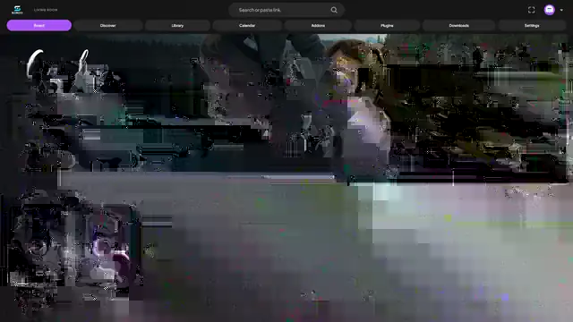

# SENZO

<p align="center">
  
  <br />
  <strong>Your media. Your space.</strong>
  <br />
  A native desktop media center for discovering, organizing, and watching movies and series.
</p>

<p align="center">
  <a href="https://github.com/Sensei002/senzo/actions/workflows/release.yml"></a>
  <a href="https://github.com/Sensei002/senzo/actions/workflows/clippy.yml"></a>
  <a href="https://github.com/Sensei002/senzo/releases"></a>
  
  
  
  <a href="https://github.com/Sensei002/senzo/blob/development/LICENSE"></a>
</p>

**SENZO** is an independent, native media center built around three things: content discovery, a flexible playback experience, and a personal media library. It brings catalogs, community add-ons, media sources, local files, downloads, and playback tools together in one desktop application.

Built with **Rust** and **Slint**, SENZO has its own interface, visual identity, settings, and local-first experience. It is designed to be responsive, customizable, and useful whether you simply want to watch something or fine-tune how your media center works.

> SENZO is actively developed. Features, integrations, and platform support can change between development builds. Check the [changelog](CHANGELOG.md) for implementation history and current changes.




---

## What SENZO offers

### Discover and explore

- Browse movies, series, anime, and other media made available by your installed catalogs and add-ons.
- Search and explore content through dedicated discovery, library, and details views.
- View rich media details, artwork, trailers, and available ratings from supported metadata providers.
- Discover community add-ons through the in-app add-on directory.
- Filter and organize catalog results using the options provided by each catalog.

### Flexible playback

- Native desktop playback powered by **MPV / libmpv**.
- Hardware-accelerated video decoding when supported by the system and available codecs.
- Audio and subtitle track selection, including independent primary and secondary subtitle controls.
- Playback speed controls, remappable keyboard shortcuts, A/B repeat, and episode-aware sleep timers.
- Picture-in-Picture mode and operating-system media controls.
- HDR playback modes and optional Anime4K / AMD FSR shader-based upscaling on supported desktop graphics hardware.
- Timeline preview thumbnails and playback recovery tools.
- Stream ranking and filtering options to help choose between available sources.

### Your library and downloads

- Local media library scanning with recursive folders, movie and episode recognition, and external subtitle discovery.
- A native download manager with pause, resume, retry, cancellation, and resumable transfers where supported by the source.
- Profile-aware app data and library organization.
- Local media playback through the integrated player.

### Make SENZO yours

- Theme Studio with semantic color controls, presets, typography, and layout customization.
- Side Rail, Top Bar, Minimal, and Classic layout presets.
- Custom colors and gradients with saved presets.
- Owner, Standard, and Kids local profiles, including optional PIN protection.
- Remappable application and playback shortcuts.
- Native localization resources for English, Portuguese, and Arabic.
- Configurable playback, subtitle, audio, and application preferences.

### Plugins

- A **Plugins** manager for Nuvio-compatible provider repositories, with per-provider on/off switches and an install box for custom repository manifests.
- Provider scripts run in a bounded QuickJS sandbox and their results appear in the provider-grouped stream drawer with a `PLUGIN` badge.
- Provider groups are kept separate in the stream drawer, so each repository and add-on has its own source block.
- Direct Sources remains an internal provider subsystem; its old sidebar entry is replaced by Plugins. See [docs/PLUGINS.md](docs/PLUGINS.md) and [docs/DIRECT_SOURCES.md](docs/DIRECT_SOURCES.md).

### Integrations

- Compatibility with Stremio-compatible catalogs and community add-ons.
- Optional integrations for supported debrid providers, including Real-Debrid, AllDebrid, Premiumize, Debrid-Link, and TorBox.
- Metadata enrichment from supported services and providers.
- Webhook and Telegram notification configuration.
- Sensitive integration credentials protected through supported operating-system credential stores.

Feature availability can depend on the installed add-on, provider, platform, network connection, and hardware.

---

## Accounts, guest mode, and your data

**You can use SENZO without signing in.** Choose **Continue without signing in** to enter the guest experience. A SENZO-owned account is not required.

- **Guest mode:** Use the available app features with a local profile and locally stored application data.
- **Optional Stremio sign-in:** Connect a Stremio account when you want to use account-connected functionality. Supported account data and synchronization are handled through Stremio's services.
- **Add-on choice stays yours:** Add-ons are managed by the user. SENZO does not bundle or silently enable Torrentio; install it yourself only if you choose to use it.
- **Local application data:** Settings, logs, and caches are stored in the operating system's local application-data area under SENZO.

SENZO does not require a separate SENZO cloud account to get started.

---

## Download SENZO

- **Stable releases:** [Download from GitHub Releases](https://github.com/Sensei002/senzo/releases).
- **Development builds:** Open [GitHub Actions](https://github.com/Sensei002/senzo/actions/workflows/release.yml), choose the latest successful desktop build, and download the Windows or Linux artifact.

Development builds can contain unfinished work and are intended for testing. For everyday use, prefer a stable release when one is available.

---

## Supported platforms and technology

| Area | Technology |
| --- | --- |
| Application core | Rust |
| Desktop interface | Slint |
| Video playback | MPV / libmpv |
| Embedded streaming | Rust-based in-process stream services |
| Local application data | Embedded database and local files |
| Desktop platforms | Windows and Linux |
| License | GPL-3.0-only |

SENZO is currently focused on the Windows and Linux desktop experience. Other platforms are not advertised as supported releases unless and until dedicated builds and platform testing are available.

---

## Build from source

### Prerequisites

**Windows**
- Rust toolchain with the MSVC target.
- Visual Studio 2022 C++ Build Tools with the x64 MSVC v143 toolset.
- Windows SDK and LLVM/Clang for native dependencies.
- The repository's vcpkg manifest and overlay triplets for native libraries.

**Linux**
- Rust toolchain.
- pkg-config, libmpv development files, and standard X11 / Wayland GUI development packages.
- A C/C++ build toolchain and the native libraries used by the project.

The GitHub Actions workflow contains the authoritative CI dependency setup for each target.

### Clone and run

```bash
git clone https://github.com/Sensei002/senzo.git
cd senzo
cargo run --release --package senzo
```

### Windows native dependencies

Before the first Windows build, install the manifest dependencies with the project's triplet so the native libraries use the same dynamic CRT configuration as Rust and Skia:

```powershell
& "$env:VCPKG_ROOT\vcpkg.exe" install `
  --x-manifest-root="$PWD" `
  --x-install-root="$PWD\vcpkg_installed" `
  --triplet=x64-windows-v3-static-md-release `
  --overlay-triplets="$PWD\triplets" `
  --overlay-ports="$PWD\vcpkg-overlays"
```

The repository's Cargo configuration discovers that installation. Do not replace the project triplet with x64-windows-static; it uses a different CRT configuration.

### Local data locations

SENZO keeps its application data in the operating system's user-data location:

- **Windows:** %LOCALAPPDATA%\SENZO
- **Linux:** $XDG_DATA_HOME/SENZO (or the user's standard local data directory when XDG_DATA_HOME is not set)

---

## Development and releases

- The development branch is the active integration branch.
- The main branch is reserved for stable work.
- Pushes to the development and main branches run the desktop build workflow for Windows and Linux.
- Version tags matching v* are used for release packaging and publication.
- Development artifacts are published by GitHub Actions and can be downloaded from the workflow run.

See [open issues](https://github.com/Sensei002/senzo/issues) for known work and [the changelog](CHANGELOG.md) for project updates.

## Contributing and feedback

Bug reports, feature suggestions, and technical feedback are welcome.

1. Search the [existing issues](https://github.com/Sensei002/senzo/issues) to avoid duplicates.
2. Include your operating system, SENZO build or commit, and relevant logs when reporting a problem.
3. For playback problems, include the source type and relevant player diagnostics where possible. Do not post private tokens, account credentials, or personal data.

---

## Project independence and third-party services

SENZO is an independent community-developed project. It is not affiliated with, authorized, maintained, sponsored, or endorsed by SmartCode Ltd or the Stremio project.

SENZO does not host or supply media streams. Catalogs, add-ons, metadata providers, debrid services, and media sources are third-party integrations selected by the user. Their availability and terms are controlled by their respective providers. Users are responsible for ensuring that their use of third-party services and content complies with applicable laws and provider terms.

### Attribution

SENZO's product direction and media-center experience were inspired by the [Stremio](https://github.com/Stremio) and [Nuvio](https://github.com/NuvioMedia) projects. We credit the Stremio team and the Nuvio team, together with their contributors, for their work on open media discovery, add-ons, and provider tooling. SENZO remains an independent project and is not affiliated with either team.

The timeline preview scheduler uses interaction and seek strategies based on [ThumbFast](https://github.com/po5/thumbfast), licensed under the Mozilla Public License 2.0. The source notice, referenced Lua snapshot hash, and license are recorded in [licenses/thumbfast/NOTICE.md](licenses/thumbfast/NOTICE.md).

SENZO is distributed under the [GNU General Public License v3.0](LICENSE).
