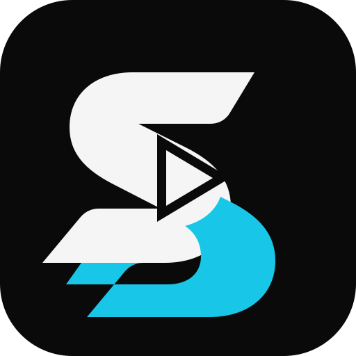

# SENZO

  

<h1 align="center">SENZO</h1>

A native desktop media center for Windows and Linux.

SENZO is being built with **Rust + GPUI** around a cinematic, library-first media experience. It is designed as a native desktop application, not a web wrapper.

> **Status:** Early development. APIs, features, and architecture are subject to change.

## Brand

- Primary background: `#0A0A0A`
- Primary foreground: `#F5F5F5`
- Accent cyan: `#18C7E8`
- Master artwork: [SENZO mark](assets/branding/senzo-mark.svg) · [Wordmark](assets/branding/senzo-wordmark.svg)

## Project principles

- Native desktop UI built with Rust and GPUI.
- Windows and Linux are the supported platforms; mobile is out of scope.
- MPV is the planned playback engine.
- SQLite is the planned local data store.
- Provider and add-on integrations are isolated behind internal interfaces.
- Builds and releases are produced through GitHub Actions.

## Development

Active development takes place on the `development` branch. The `main` branch is reserved for stable releases.

See [Architecture](docs/ARCHITECTURE.md) and [Roadmap](docs/ROADMAP.md).

## License

A license has not yet been selected. Until a license is added, all rights are reserved by the repository owner.
