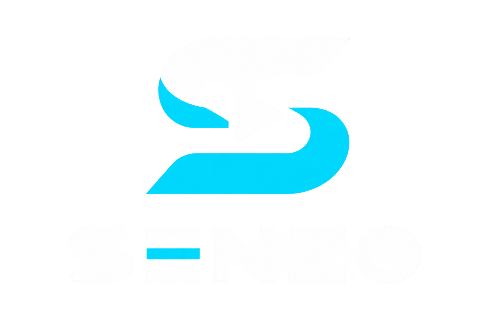

  

<h1 align="center">SENZO</h1>

<strong>A native Rust desktop media center.</strong>

<em>Nuvio's desktop experience, re-engineered for Rust and GPUI CE.</em>

SENZO is a native desktop rewrite of Nuvio Desktop. The goal is desktop feature and workflow parity, implemented in Rust under the SENZO name—not a browser wrapper or a loosely similar media player.

## Technology boundary

- **Language:** Rust 2024.
- **Native UI:** GPUI Community Edition (GPUI CE), pinned to 0.2.2.
- **Platforms:** Windows and Linux.
- **Playback target:** MPV/libmpv behind a SENZO-owned Rust interface; playback integration is a later phase.
- **Not used:** WebView2, Electron, Tauri, egui, or embedded browser UI.
- **Build and validation:** GitHub Actions.

All application screens and player controls will be native GPUI. The previous prototype's WebView2/player-surface implementation is not part of the new application path.

## Rewrite status

- **Phase 0 — Source audit and architecture reset:** complete.
- **Phase 1 — Clean Rust workspace and technical foundation:** complete; Windows and Linux native builds, workspace checks and startup/render/shutdown smoke tests passed.
- **Phase 2 — Native GPUI application shell and design system:** implementation and automated CI acceptance passed; manual visual acceptance is still pending.
- **Phase 3 — Networking, metadata and artwork foundation:** in progress; native Home, Search, Movie/TV/Person Details, metadata and artwork services are implemented on `development`. Desktop CI #457 passed on Windows and Linux. The person metadata route is implemented on SENZO API `development` with passing API CI #10; [API PR #1](https://github.com/Sensei002/senzo-api/pull/1) awaits merge/deployment. Live hosted-service and runtime outage-recovery acceptance remain.

The Phase 3 metadata client targets the hosted SENZO API at senzo-api.vercel.app. It models search, trending, popular, movie/TV/person details, combined cast/crew credits, external IDs, credits, videos, images, seasons and episodes. The person profile and combined-credits route is implemented on the API `development` branch but is not production-live until API PR #1 is merged and deployed. The client validates inputs, coalesces duplicate requests, supports cancellation and bounded retries, caps response sizes, and applies a bounded in-memory response cache. It never sends a TMDB credential or Authorization header; TMDB authentication stays server-side.

The `senzo-artwork` crate resolves TMDB image paths, downloads without following redirects, validates MIME types and image signatures, enforces compressed/decompressed size limits, decodes JPEG/PNG/WebP to RGBA8, and maintains bounded memory and disk caches. The native Home screen requests real trending metadata and renders poster/backdrop artwork through native GPUI components. Search uses a native GPUI text input, a 350 ms debounce, cancellation of superseded requests, All/Movies/TV filters, hosted metadata results, validated poster/profile artwork and a quick-preview panel. Movie/TV Details provide metadata and TV season/episode browsing; Person Details provide profile, biography, personal facts and cast/crew filmography shelves. Full Nuvio Search parity (recent history, add-on catalogues, discover filters and pagination), live hosted-service acceptance and offline/provider-error runtime acceptance remain.

The previous monolithic prototype has been removed from the active source tree. Its history remains available in Git; it is not the architecture baseline for the rewrite.

## Initial workspace

| Crate | Responsibility |
|---|---|
| senzo-app | Process entry point, service composition and Tokio runtime ownership. |
| senzo-ui | Native GPUI application shell, design system, route navigation and GPUI-safe async updates. |
| senzo-domain | Typed domain models and repository contracts. |
| senzo-metadata | Typed SENZO API client, TMDB-shaped response models, request coalescing and metadata response cache. |
| senzo-artwork | TMDB artwork URL resolution, bounded download/decode, validation and memory/disk caches. |
| senzo-network | Shared HTTP client policy and URL validation. |
| senzo-storage | SQLite repositories and transactional migrations. |
| senzo-platform | OS paths and native credential storage. |
| senzo-diagnostics | Structured logging and credential-redaction helpers. |

The workspace will gain focused feature crates as later roadmap phases require them; it will not create a separate crate for every screen.

## Build locally

The supported toolchain is pinned in rust-toolchain.toml (Rust 1.95.0).

    cargo fmt --all -- --check
    cargo clippy --workspace --all-targets -- -D warnings
    cargo test --workspace --all-targets
    cargo run -p senzo-app

Linux builds need the GPUI development libraries listed in Development. GitHub Actions is the authoritative project validation environment.

## Documentation

- Phase 0 completion: docs/PHASE_0_COMPLETION.md
- Phase 1 implementation and acceptance record: docs/PHASE_1_COMPLETION.md
- Phase 2 shell implementation and acceptance record: docs/PHASE_2_IMPLEMENTATION.md
- Phase 3 implementation record: docs/PHASE_3_IMPLEMENTATION.md
- Nuvio source audit: docs/NUVIO_SOURCE_AUDIT.md
- Nuvio-to-SENZO feature mapping: docs/NUVIO_TO_SENZO_MAPPING.md
- Rewrite architecture: docs/ARCHITECTURE.md
- Product specification: docs/PRODUCT_SPEC.md
- Full roadmap: docs/ROADMAP.md
- Development workflow: docs/DEVELOPMENT.md
- Licensing policy: docs/LICENSING_POLICY.md
- Security policy: docs/SECURITY.md

## Repositories

- Desktop: https://github.com/Sensei002/senzo
- Metadata API: https://github.com/Sensei002/senzo-api
- Hosted metadata API: https://senzo-api.vercel.app

The existing SENZO API keeps the TMDB Read Access Token server-side. The desktop binary must never contain the shared TMDB secret.

## Branches

- main — stable releases only.
- development — active rewrite and integration work.

## Source and provider policy

SENZO ports Nuvio desktop behavior and architecture, not Nuvio branding or artwork. Torrentio remains an optional, explicitly user-installed Stremio add-on; it is never bundled, silently installed, or enabled by default. Provider responses, manifests, plugin data, subtitles and media URLs are untrusted input.

SENZO is licensed under GPL-3.0-only. See Licensing and preserve applicable third-party notices when dependencies are added.
