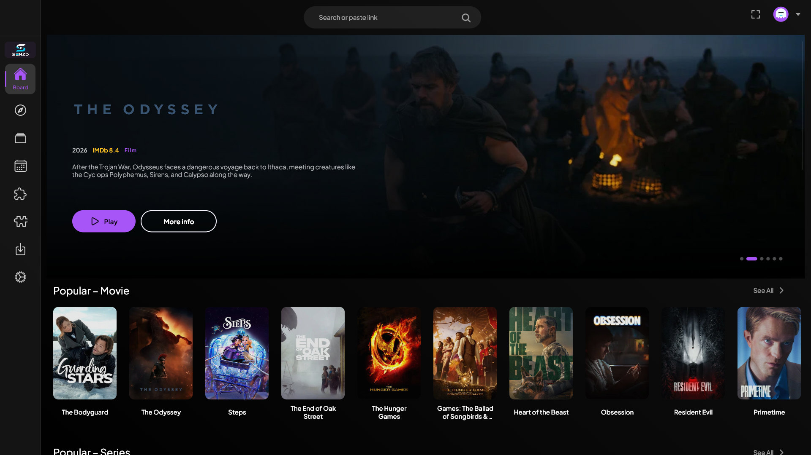

# SENZO

<p align="center">
  
  <br />
  <strong>Your media. Your space.</strong>
  <br />
  A native media center for desktop and Android.
</p>

<p align="center">
  <a href="https://github.com/Sensei002/senzo/actions/workflows/release.yml"></a>
  <a href="https://github.com/Sensei002/senzo/actions/workflows/android.yml"></a>
  <a href="https://github.com/Sensei002/senzo/actions/workflows/clippy.yml"></a>
  <a href="https://github.com/Sensei002/senzo/releases"></a>
  
  <a href="https://github.com/Sensei002/senzo/blob/development/LICENSE"></a>
</p>

<p align="center">
  
</p>

**SENZO** is an independent, native media center built around content discovery, flexible playback, and a personal media library. It brings catalogs, community add-ons, provider plugins, media sources, local files, downloads, and playback tools together in one application.

The desktop app is written in **Rust** with a **Slint** interface. The Android app is written in **Kotlin** with **Jetpack Compose**. Both clients use the same Stremio-compatible add-on ecosystem; signing in with the same Stremio account brings that account's add-on collection to either app.

> SENZO is actively developed. Features and platform support can change between development builds. See the [changelog](CHANGELOG.md) for current changes.

---

## One library, two native apps

| | Desktop | Android |
| --- | --- | --- |
| **Platforms** | Windows, Linux, macOS | Android 8.0 and newer |
| **Interface** | Native Slint UI | Native Jetpack Compose UI |
| **Playback** | MPV / libmpv | Media3/ExoPlayer or libmpv |
| **Best for** | Full media-center setup, local library, downloads, themes, and advanced playback | Watching and browsing on a phone or tablet |
| **Library source** | Stremio add-ons, Plugins, local folders, and torrent files | Stremio add-ons, Plugins, and torrent or HTTP streams |

Both clients support guest use. Signing in with a Stremio account is optional; when you do sign in, the add-ons installed on that account are available in the app.

---

## Quick start

### Desktop

#### 1. Download the right package

Open the [latest release](https://github.com/Sensei002/senzo/releases/latest) and choose the file that matches your computer:

| Platform | File to download | Notes |
| --- | --- | --- |
| **Windows x64** | `SENZO-Setup-v*-x64.exe` | Recommended. Installs SENZO and the runtime it needs. |
| **Windows x64 updater package** | `senzo-v*-x86_64-pc-windows-msvc.zip` | Contains the installer used by the automatic updater. |
| **Debian / Ubuntu x64** | `senzo_*_amd64.deb` | Installs from the package manager. |
| **Arch Linux x64** | `senzo-*-x86_64.pkg.tar.zst` | Native Arch package. |
| **Fedora / Red Hat x64** | `senzo-*.rpm` | Native RPM package. |
| **Linux x64 portable** | `senzo-v*-x86_64-unknown-linux-gnu` | Single executable; system libraries such as libmpv are still required. |
| **macOS Apple silicon** | `senzo-v*-aarch64-apple-darwin.dmg` | For M1, M2, M3, M4 and newer Macs. |
| **macOS Intel** | `senzo-v*-x86_64-apple-darwin.dmg` | For Intel Macs. |

#### 2. Install and launch

**Windows**

1. Run the setup file and complete the installer.
2. Launch **SENZO** from the Start menu or the desktop shortcut.

**Debian / Ubuntu**

```bash
sudo apt install ./senzo_*_amd64.deb
```

**Arch Linux**

```bash
sudo pacman -U senzo-*-x86_64.pkg.tar.zst
```

**Fedora / Red Hat**

```bash
sudo dnf install ./senzo-*.rpm
```

**Linux portable binary**

```bash
chmod +x senzo-v*-x86_64-unknown-linux-gnu
./senzo-v*-x86_64-unknown-linux-gnu
```

If the portable binary reports missing libraries, install the matching package instead or install libmpv and the desktop runtime libraries used by your distribution.

**macOS**

1. Open the DMG.
2. Drag **SENZO** into **Applications**.
3. Launch it from Applications. If macOS blocks the first launch, Control-click the app, choose **Open**, and confirm.

#### 3. Choose an account or continue as a guest

On the welcome screen you can:

- **Continue without signing in** to use a local guest profile.
- **Sign in with Stremio** if you want the add-ons from that account to appear automatically.

You can change this later in **Settings**. No separate SENZO cloud account is required.

#### 4. Install add-ons for something to watch

SENZO does not bundle media catalogs or install Torrentio for you. Add-ons supply the catalogs and streams:

1. Open **Add-ons**.
2. Browse the community directory or install an add-on from its manifest URL.
3. Return to **Board** or **Discover** and open a catalog.
4. Select a movie or episode to see its details.

**Plugins** are separate from add-ons. The Plugins tab manages Nuvio-compatible provider repositories for extra stream sources. Installing a repository does not automatically enable every provider inside it; turn on the providers you trust.

#### 5. Play something

1. Open a title from **Board**, **Discover**, **Search**, or **Library**.
2. Choose **Play** or open the stream list.
3. Pick a source. SENZO can rank and filter sources by quality, seeders, and provider.
4. Use the player controls for audio tracks, subtitles, speed, picture-in-picture, and fullscreen.

You can also add local folders in **Library**, open a `.torrent` file directly, or send a supported link to SENZO. Torrent playback may buffer briefly while the first pieces arrive, then continues while it downloads.

---

### Android

#### 1. Download the APK for your phone

Open the [latest release](https://github.com/Sensei002/senzo/releases/latest) and find the Android files:

| Device | File to download |
| --- | --- |
| **Most phones and tablets** | `senzo-v*-r*-arm64-v8a.apk` |
| **Older 32-bit devices** | `senzo-v*-r*-armeabi-v7a.apk` |

Use the **arm64** build unless you know your device is 32-bit. SENZO for Android requires **Android 8.0 (API 26) or newer**.

#### 2. Install the APK

1. Open the downloaded APK from your browser or file manager.
2. If Android blocks the install, allow your browser or file manager to **install unknown apps**, then return and confirm the install.
3. Launch **SENZO** from your app drawer.

SENZO is distributed directly through GitHub Releases and is not currently on Google Play. Updates are downloaded inside the app from **Settings**.

#### 3. Sign in or continue as a guest

- **Continue without an account** starts with the official guest add-ons.
- **Sign in** with the same Stremio account you use on desktop to load that account's add-on collection.

#### 4. Add catalogs and play

1. Open **Add-ons** to browse the directory, install an add-on, or manage the ones already on your account.
2. Return to the home board, or use **Search** to find a title.
3. Open a movie or episode, choose a stream, and tap **Play**.
4. Use the player for subtitles, audio tracks, speed, and fullscreen.

Android supports both direct HTTP streams and torrent streams. Torrents may take a few seconds to start while the first pieces are verified. If playback is choppy with the default engine, open **Settings -> Player engine** and try **libmpv**; Media3 is usually lighter on battery.

**Plugins** work on Android too: open the **Plugins** tab, install a compatible repository, enable the providers you want, and choose them from the stream list for a title.

---

## If something does not play

- **No catalogs:** install at least one add-on, then return to the board and refresh.
- **No streams for a title:** the add-on may not provide sources for that title, or its provider may be offline. Try another add-on, plugin, or source filter.
- **Android says "App not installed":** check that you downloaded the arm64 build for a 64-bit phone or the armeabi-v7a build for an older 32-bit device, and that Android 8.0 or newer is installed.
- **Android blocks the download:** allow installs from the browser or file manager you used, then retry.
- **macOS says the app is from an unidentified developer:** Control-click **SENZO** in Applications, choose **Open**, and confirm. The published DMGs are ad-hoc signed rather than notarized.
- **A torrent takes a while to start:** SENZO waits for a verified opening piece before playback so it does not start in the middle. Give it a few seconds on slower swarms.
- **Linux portable binary will not start:** install libmpv and the GTK/X11 or Wayland libraries listed by your distribution, or use the DEB, Arch, or RPM package.

For playback bugs, include the platform, SENZO version, source type, and a player log where possible. Never post account passwords, debrid tokens, or other private credentials.

---

## What SENZO offers

### Shared by desktop and Android

- Stremio-compatible catalogs, metadata, and add-ons.
- Guest mode with official add-ons, or optional Stremio account sign-in.
- Provider plugins from Nuvio-compatible repositories, with per-provider controls.
- Search, details, seasons, episodes, and ranked stream selection.
- HTTP and torrent playback where the source supports it.
- A focused, dark-first interface with OLED-friendly themes.

### Desktop extras

- **MPV / libmpv playback** with hardware decoding, HDR modes, optional Anime4K / AMD FSR upscaling, and detailed track controls.
- **Local library:** recursive folder scanning, movie and episode recognition, and external subtitle discovery.
- **Downloads:** pause, resume, retry, and cancel transfers where the source supports them.
- **Theme Studio:** semantic colors, gradients, typography, and Side Rail, Top Bar, Minimal, or Classic layouts.
- **Profiles and shortcuts:** owner, standard, and kids profiles with optional PIN protection, plus remappable keyboard controls.
- **Desktop integrations:** picture-in-picture, operating-system media controls, Discord Rich Presence, webhooks, and Telegram notifications.
- **Direct `.torrent` opening** from the file manager, including when SENZO is already running.

### Android extras

- **Native Compose interface** designed for touch, with a bottom navigation bar and OLED black surfaces.
- **Two player engines:** Media3/ExoPlayer for hardware-efficient playback, or libmpv for broader format support.
- **On-device torrent streaming** with a cache you can clear from Settings.
- **In-app updates** from GitHub Releases, with the correct APK selected for your device.
- **Local watch history and resume points**, plus recent searches and preferences kept on the device.

Feature availability depends on the installed add-on, provider, source, network, and hardware.

---

## Accounts, guest mode, and your data

**You can use SENZO without signing in.** Choose **Continue without signing in** on desktop or **Continue without an account** on Android.

- **Guest mode:** uses a local profile and locally stored application data. The Android guest profile starts with the official add-ons.
- **Optional Stremio sign-in:** connects the Stremio account you already use. Account data and add-on synchronization are handled through Stremio's services.
- **Add-on choice stays yours:** add-ons are managed by the user. SENZO does not bundle or silently enable Torrentio.
- **Local application data:** desktop settings, logs, caches, and library data stay in the operating system's local application-data area under SENZO. Android data stays in the app's private storage.

Desktop data locations:

- **Windows:** `%LOCALAPPDATA%\SENZO`
- **Linux:** `$XDG_DATA_HOME/SENZO` (or the standard local data directory when `XDG_DATA_HOME` is unset)
- **macOS:** the standard application-support directory under your user Library.

SENZO does not require a separate SENZO cloud account to get started.

---

## Downloads and updates

- **Stable releases:** [GitHub Releases](https://github.com/Sensei002/senzo/releases/latest).
- **Android updates:** open **Settings** in the app. If a newer release publishes an APK, SENZO offers the download and install flow there.
- **Development builds:** open [GitHub Actions](https://github.com/Sensei002/senzo/actions) and choose a successful desktop or Android build. Development builds can contain unfinished work.

Download SENZO only from this repository or its GitHub Releases page. Builds republished by third parties are not verified by the project.

---

## Supported platforms

| Platform | Requirements | Package |
| --- | --- | --- |
| **Windows** | Windows 10 or 11, x64 | Inno Setup installer or updater ZIP |
| **Linux** | x64, X11 or Wayland | DEB, Arch package, Fedora RPM, or portable binary |
| **macOS** | macOS 12 or newer, Apple silicon or Intel | DMG |
| **Android** | Android 8.0 (API 26) or newer, arm64 or armeabi-v7a | APK |

| Area | Technology |
| --- | --- |
| Desktop core and interface | Rust, Slint |
| Android app | Kotlin, Jetpack Compose |
| Desktop playback | MPV / libmpv |
| Android playback | Media3/ExoPlayer or libmpv |
| Embedded streaming | Rust-based in-process stream services |
| Local application data | Embedded database and local files |
| License | GPL-3.0-only |

The Android client is intentionally focused on the watch flow: discover, search, open details, choose a source, and play. The desktop client carries the larger customization, local-library, download, and theming feature set.

---

## Build from source

### Desktop prerequisites

**Windows**

- Rust toolchain with the MSVC target.
- Visual Studio 2022 C++ Build Tools with the x64 MSVC v143 toolset.
- Windows SDK and LLVM/Clang for native dependencies.
- The repository's vcpkg manifest and overlay triplets for native libraries.

**Linux**

- Rust toolchain.
- pkg-config, libmpv development files, and standard X11 / Wayland GUI development packages.
- A C/C++ build toolchain and the native libraries used by the project.

**macOS**

- Rust toolchain.
- Xcode Command Line Tools and the native dependencies installed by the macOS workflow.

The GitHub Actions workflows contain the authoritative dependency setup for each target.

### Clone and run the desktop app

```bash
git clone https://github.com/Sensei002/senzo.git
cd senzo
cargo run --release --package senzo
```

### Windows native dependencies

Before the first Windows build, install the manifest dependencies with the project triad so the native libraries use the same dynamic CRT configuration as Rust and Skia:

```powershell
& "$env:VCPKG_ROOT\vcpkg.exe" install `
  --x-manifest-root="$PWD" `
  --x-install-root="$PWD\vcpkg_installed" `
  --triplet=x64-windows-v3-static-md-release `
  --overlay-triplets="$PWD\triplets" `
  --overlay-ports="$PWD\vcpkg-overlays"
```

Do not replace the project triplet with `x64-windows-static`; it uses a different CRT configuration.

### Build the Android app

Requirements: JDK 17 or newer, Android SDK platform 35, and build-tools 35.0.0. The project uses Gradle 8.11.1.

```bash
cd android
gradle :app:assembleRelease
```

The APK is written under `android/app/build/outputs/apk/release/`. The version name comes from `app/Cargo.toml`; CI overrides it from the release tag. Signing variables and local release-key setup are documented in [android/README.md](android/README.md).

---

## Development and releases

- `development` is the active integration branch. Pushes run the desktop builds and Clippy; Android changes also run the Android workflow.
- `main` is the stable branch. Clippy runs on pushes and pull requests.
- Version tags matching `v*` run the desktop release workflow and publish the GitHub release.
- Release APKs are published as assets on the matching release and are picked up by the in-app Android updater.
- Development artifacts are available from successful GitHub Actions runs.

See [open issues](https://github.com/Sensei002/senzo/issues) for known work, [the changelog](CHANGELOG.md) for project history, and [docs/PLUGINS.md](docs/PLUGINS.md) for the plugin repository format and sandbox limits.

## Contributing and feedback

Bug reports, feature suggestions, and technical feedback are welcome.

1. Search the [existing issues](https://github.com/Sensei002/senzo/issues) to avoid duplicates.
2. Include your operating system, SENZO version or commit, and relevant logs when reporting a problem.
3. For playback problems, include the source type and player diagnostics where possible. Do not post private tokens, account credentials, or personal data.

---

## Project independence and third-party services

SENZO is an independent community-developed project. It is not affiliated with, authorized, maintained, sponsored, or endorsed by SmartCode Ltd or the Stremio project.

SENZO does not host or supply media streams. Catalogs, add-ons, metadata providers, debrid services, and media sources are third-party integrations selected by the user. Their availability and terms are controlled by their respective providers. Users are responsible for ensuring that their use of third-party services and content complies with applicable laws and provider terms.

### Attribution

SENZO's product direction and media-center experience were inspired by the [Stremio](https://github.com/Stremio) and [Nuvio](https://github.com/NuvioMedia) projects. We credit the Stremio team and the Nuvio team, together with their contributors, for their work on open media discovery, add-ons, and provider tooling. SENZO remains an independent project and is not affiliated with either team.

The timeline preview scheduler uses interaction and seek strategies based on [ThumbFast](https://github.com/po5/thumbfast), licensed under the Mozilla Public License 2.0. The source notice, referenced Lua snapshot hash, and license are recorded in [licenses/thumbfast/NOTICE.md](licenses/thumbfast/NOTICE.md).

SENZO is distributed under the [GNU General Public License v3.0](LICENSE).
